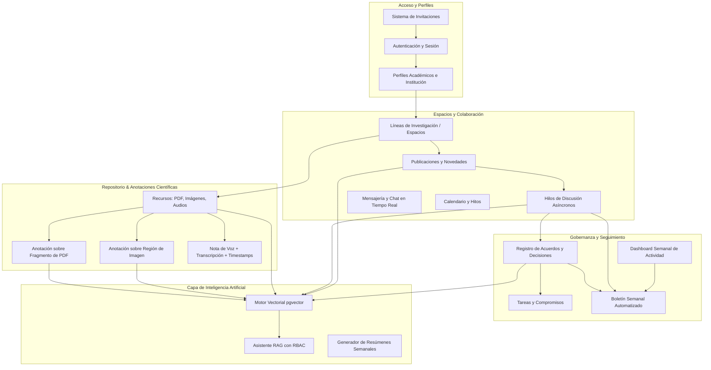
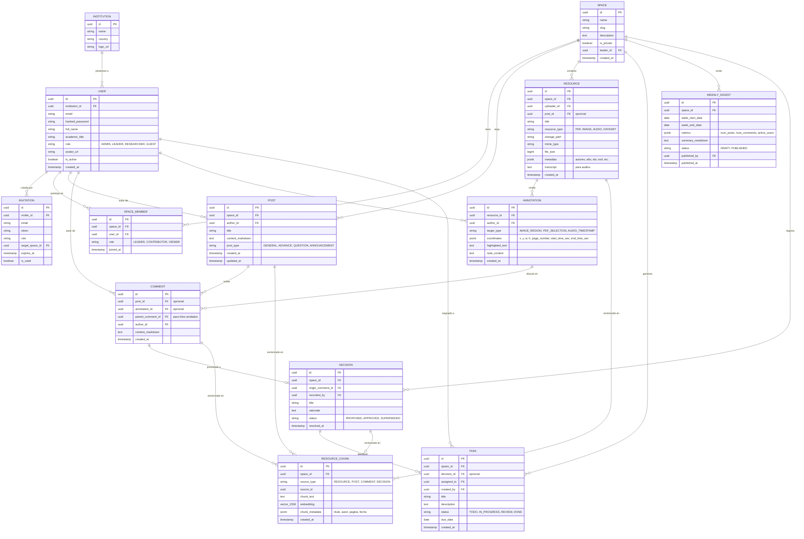

# Especificación de Requisitos del Sistema y Modelo de Datos (ERD)
## C3pa — Plataforma de Colaboración y Modelado Metabólico con Asistente RAG

**Proyecto:** C3pa / Consorcio Metabólico C3  
**Escala:** 30 a 80 investigadores e instituciones socias  
**Modo de acceso:** Registro restringido por invitación  
**Arquitectura base:** Backend FastAPI (Python) + PostgreSQL (con `pgvector`) + Storage S3/MinIO + Frontend Angular (TypeScript)  
**Estado:** Documento de Diseño y Arquitectura v1.0  

---

## 1. Visión y Objetivos

La plataforma es un entorno de trabajo colaborativo asíncrono para un consorcio científico. Su objetivo es sustituir la dependencia de reuniones presenciales mediante:
1. **Discusión científica contextualizada:** No solo compartir archivos, sino discutir sobre regiones específicas de imágenes, fragmentos de PDFs y marcas de tiempo de notas de voz.
2. **Formalización de la memoria institucional:** Distinguir claramente entre opiniones, propuestas, decisiones consensuadas y tareas asignadas.
3. **Monitoreo y rendición de cuentas:** Tableros semanales de actividad cuantitativa y avance científico cualitativo.
4. **Inteligencia contextual (RAG):** Asistente de IA con permisos de acceso integrados, capaz de responder preguntas sobre avances, acuerdos y bibliografía con citas trazables a las fuentes.

---

## 2. Actores y Roles del Sistema

| Rol | Descripción | Permisos Clave |
| :--- | :--- | :--- |
| **Coordinador General** (Admin) | Investigador principal / Administrador general | Generar invitaciones, crear líneas de investigación, configurar la IA, publicar boletines oficiales, supervisar métricas. |
| **Líder de Línea** | Responsable de un subgrupo o paquete de trabajo | Moderar el espacio de su línea, formalizar acuerdos/decisiones, asignar tareas, aprobar resúmenes temáticos. |
| **Investigador / Colaborador** | Investigador de instituciones asociadas | Publicar avances, subir artículos/fotos/audios, crear anotaciones, participar en hilos y chats, consultar al RAG. |
| **Invitado / Evaluador** (Opcional) | Revisor externo o auditor | Acceso de solo lectura a espacios públicos del proyecto y boletines, sin capacidad de edición ni acceso a espacios privados. |

---

## 3. Módulos Funcionales



### 3.1. Acceso e Invitaciones
- El acceso está cerrado al público. Solo los usuarios con un token de invitación válido pueden registrarse.
- Las invitaciones se envían por correo o mediante enlace único generado por los coordinadores.
- Cada invitación puede predefinir la institución de origen y los espacios temáticos asignados.

### 3.2. Espacios Temáticos (Líneas de Investigación)
- El consorcio tiene un **Espacio Principal** (transversal a todos los miembros) y **Espacios por Línea de Investigación**.
- Cada espacio cuenta con su propio muro de publicaciones, repositorio de recursos, lista de tareas y foro de discusión.

### 3.3. Repositorio Multimedia con Anotaciones Profundas
- **Artículos y Documentos (PDF):**
  - Visor interactivo integrado.
  - El usuario puede seleccionar un fragmento de texto o dibujar un área rectangular en una página.
  - Cada anotación abre un hilo de discusión lateral contextualizado.
- **Fotografías y Micrografías:**
  - Visor con zoom y coordenadas espaciales ($x, y, w, h$).
  - Marcadores puntuales o polígonos donde los investigadores comentan detalles experimentales.
- **Notas de Voz:**
  - Grabación directa o subida de audio desde navegador/móvil.
  - Transcripción automática (ej. Whisper) indexada en texto con enlaces a momentos exactos del audio (timestamps).

### 3.4. Formalización de Acuerdos y Decisiones
- Para evitar que los consensos se pierdan en interminables hilos de discusión, cualquier hilo permite promover un comentario a **"Acuerdo / Decisión Formal"**.
- Los acuerdos tienen estado (*Propuesta, Consensuado, Ejecutado*), fecha de resolución y pueden originar directamente **Tareas con Responsables y Fechas Límite**.

### 3.5. Dashboard y Boletín Semanal
- **Dashboard Cuantitativo:** Gráficos de actividad semanal (publicaciones, comentarios por día, documentos aportados, usuarios activos).
- **Dashboard Cualitativo:** Nuevos acuerdos registrados, tareas completadas vs pendientes, temas más discutidos.
- **Boletín Semanal Asistido:** Generador de borrador de newsletter semanal que compila los avances de cada línea. Un coordinador lo revisa y lo publica con un clic para enviarlo por correo o notificación.

### 3.6. Asistente RAG con Filtro de Privacidad (RBAC)
- Capa de LLM desacoplada (interfaz universal para soportar APIs comerciales como Gemini/OpenAI o modelos locales como Ollama/vLLM).
- **Control de Acceso Estricto:** Cuando el investigador hace una pregunta al RAG, la consulta vectorial se filtra únicamente sobre los fragmentos pertenecientes a los espacios a los que dicho usuario tiene permiso de lectura.
- **Respuestas con Citas Verificables:** Cada afirmación generada incluye enlaces directos al documento, comentario o anotación de origen.

---

## 4. Diagrama Entidad-Relación (ERD)



---

## 5. Diccionario de Datos Clave

### 5.1. Manejo de Anotaciones Científicas (`ANNOTATION`)
La columna `coordinates` es un JSONB flexible que almacena:
- Para **imágenes**: `{"type": "box", "x": 0.25, "y": 0.40, "width": 0.15, "height": 0.10}` (coordenadas relativas 0.0 - 1.0 para soportar cualquier resolución).
- Para **PDFs**: `{"page": 4, "rects": [[100, 250, 400, 270]], "selection_range": [1240, 1315]}`.
- Para **Audios**: `{"start_time": 45.2, "end_time": 62.0}` (permite reproducir directamente el segmento discutido).

### 5.2. Capa de Vectorización y RAG (`RESOURCE_CHUNK`)
- Cada vez que se sube un PDF, audio (trascrito), publicación o decisión formal, un proceso asíncrono divide el texto en fragmentos (*chunks* de ~500 tokens con overlap de 50).
- Cada chunk guarda su `space_id`.
- Cuando un usuario consulta al chatbot:
  ```sql
  SELECT chunk_text, chunk_metadata, (embedding <=> query_vector) AS distance
  FROM resource_chunk
  WHERE space_id IN (SELECT space_id FROM space_member WHERE user_id = :current_user_id)
  ORDER BY distance ASC
  LIMIT 5;
  ```
  Esto garantiza a nivel de base de datos que **ningún investigador pueda recuperar fragmentos de espacios a los que no tiene acceso**.

---

## 6. Fases de Desarrollo Recomendadas

### Fase 1: Núcleo Colaborativo (MVP)
- Autenticación por invitación y gestión de perfiles.
- Espacios temáticos (Líneas de investigación) y publicaciones tipo muro con Markdown.
- Hilos de comentarios y menciones de usuarios.
- Subida de archivos básicos a almacenamiento local / S3.

### Fase 2: Herramientas Científicas Especializadas
- Visor de PDF con resaltado y comentarios vinculados a fragmentos.
- Visor de imágenes con anotación por regiones.
- Grabación y subida de notas de voz con transcripción automática mediante Whisper.
- Módulo de Acuerdos/Decisiones y Tareas derivadas.

### Fase 3: Asistente RAG & Vectorización
- Integración de `pgvector` en PostgreSQL.
- Ingesta automática de documentos, publicaciones y decisiones.
- Interfaz de chatbot integrada en el portal con citas clicables.
- Capa de LLM configurable (Ollama/vLLM o API externa).

### Fase 4: Dashboards y Boletines Automáticos
- Tablero de métricas cuantitativas y cualitativas de la semana.
- Generador de boletín semanal borrador asistido por IA.
- Notificaciones por correo electrónico y resúmenes periódicos.

---

## 7. Arquitectura Institucional: Ecosistema C3pa (Inspiración PLIIS FacMed UNAM)

Inspirado en el **Programa de Liderazgo e Innovación Interprofesional en Salud (PLIIS)** de la Facultad de Medicina de la UNAM, la plataforma C3pa unifica las tres dimensiones científicas del consorcio:

### 7.1. Pilares Fundamentales del Consorcio C3pa
1. **Pilar I: Modelado GEM & Microbioma (Bases Metabólicas Vivas):**
   - Vinculación directa con modelos computacionales del `procesador` metabólico.
   - Integración de FBA (Flux Balance Analysis), biomasa de celulosa bacteriana y consorcios microbianos.
2. **Pilar II: Memoria Científica Viva & RAG con Whisper:**
   - Asistente de inteligencia artificial indexando artículos PDF, transcripciones de voz y decisiones.
   - Dictado por voz universal con OpenAI Whisper en todos los formularios y cajas de texto de la plataforma.
3. **Pilar III: Gobernanza Colegiada & Trazabilidad Interinstitucional:**
   - Acuerdos formales de laboratorio, hitos de calendario y compromisos entre laboratorios de UNAM, CINVESTAV y C3.

### 7.2. Identidad Visual y Estilo Institucional
- **Paleta UNAM/Oxford Institucional:** Fondo principal sobrio `#0f172a` y `#091224`, azul marino heráldico `#1e3a8a`, con acentos dorados `#f59e0b` y `#fbbf24`.
- **Navegación Interprofesional Centralizada:** Acceso rápido desde el Hub principal a los espacios de discusión, biblioteca indexada, acuerdos colegiados y calendario de hitos experimentales.

