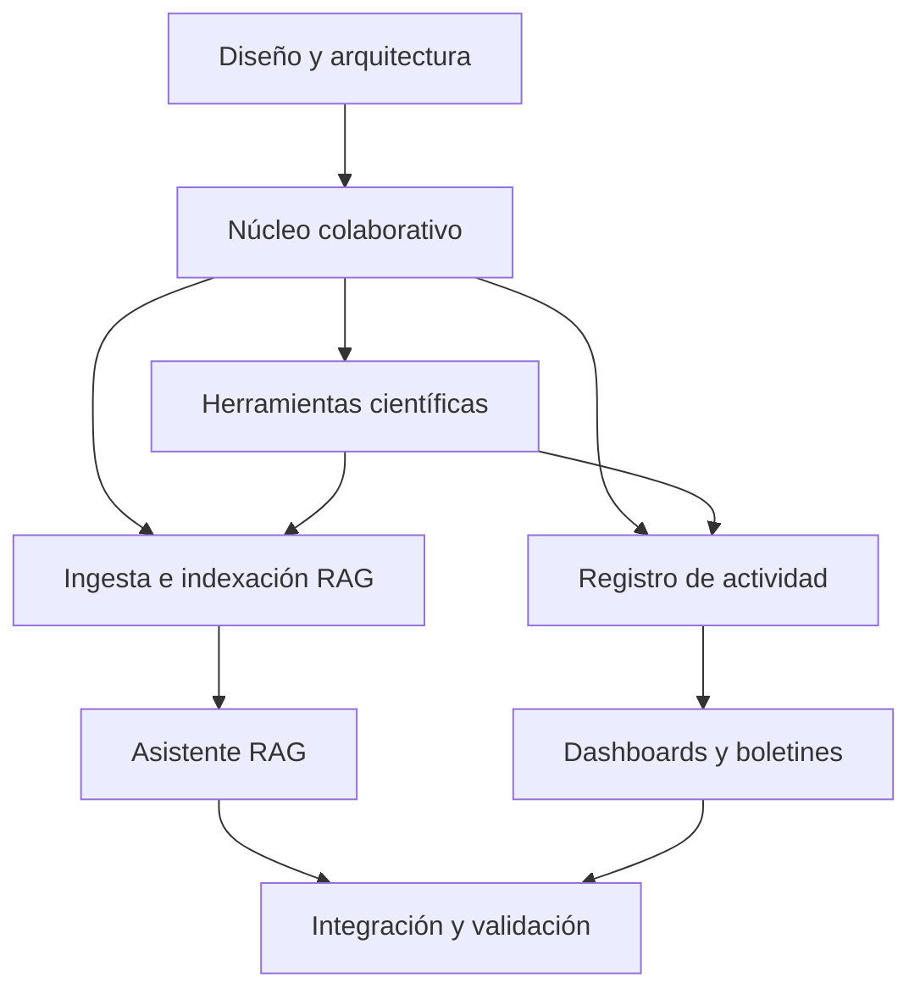
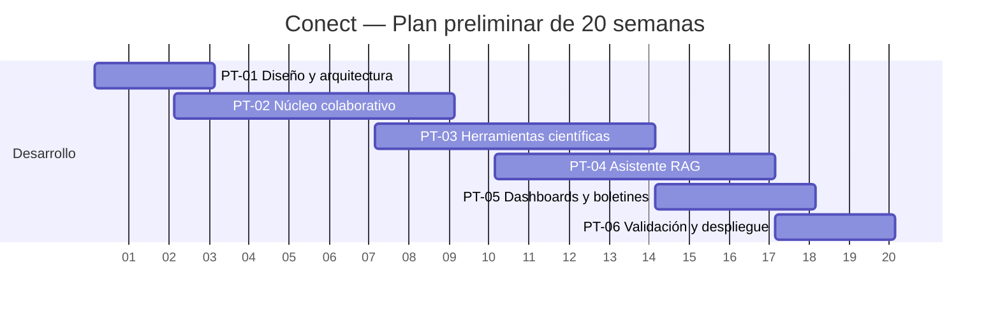

# Plan de Trabajo y Arquitectura de Desarrollo
## C3pa — Plataforma de Colaboración y Modelado Metabólico con Asistente RAG

**Proyecto:** C3pa / Consorcio Metabólico C3  
**Escala prevista:** 30 a 80 investigadores e instituciones socias  
**Acceso:** Registro restringido por invitación  
**Arquitectura de referencia:** FastAPI (Python) + PostgreSQL/pgvector + S3/MinIO + Angular (TypeScript)  
**Versión:** 1.0 — Propuesta de plan de trabajo  
**Documento de partida:** *Especificación de Requisitos del Sistema y Modelo de Datos (ERD), v1.0*  
**Nota:** Los tiempos y la distribución de responsabilidades son preliminares; deberán ajustarse a la disponibilidad real del equipo.

---

## 1. Objetivo y alcance

Desarrollar una plataforma **propia** para la colaboración científica asíncrona de un consorcio de investigación. La plataforma permitirá compartir y discutir documentos y materiales multimedia, registrar acuerdos y tareas, dar seguimiento al avance colectivo y consultar el conocimiento acumulado mediante un asistente RAG.

HumHub puede utilizarse como **referencia funcional**, pero el producto se desarrollará con su propia base de código, arquitectura, interfaz y modelo de datos.

### Objetivos específicos

1. Habilitar cuentas, invitaciones, roles y espacios de colaboración con permisos verificables.
2. Permitir publicaciones, comentarios anidados, mensajería, notificaciones y compartición de archivos.
3. Facilitar anotaciones científicas sobre regiones de imágenes, fragmentos de PDF y momentos de audio.
4. Formalizar acuerdos y decisiones, asignar tareas y conservar trazabilidad entre conversaciones y resultados.
5. Producir indicadores de actividad y avance, así como boletines semanales revisables.
6. Ofrecer un asistente RAG con fuentes citables y control de acceso coherente con el resto del sistema.

### Alcance inicial

El sistema atenderá un solo consorcio, con un espacio transversal y espacios por líneas de investigación. Se priorizará la colaboración asíncrona. Las videoconferencias integradas no forman parte del alcance definido en el documento de partida.

---

## 2. Principios de diseño y decisiones técnicas

- **Monolito modular al inicio:** Backend FastAPI con módulos separados por dominio (identidad, espacios, contenido, archivos, colaboración, seguimiento). Evitar microservicios innecesarios en la primera versión.
- **Frontend independiente:** Angular (TypeScript), con API estable y componentes reutilizables.
- **Persistencia:** PostgreSQL para entidades transaccionales y `pgvector` para recuperación semántica; S3/MinIO para archivos; Redis y procesos de trabajo para tareas asíncronas si su uso se justifica.
- **Autorización consistente:** Los permisos se verificarán en cada operación; la búsqueda y el RAG no podrán omitir esas reglas.
- **Trazabilidad:** Publicaciones, anotaciones, acuerdos y tareas deberán conservar referencias a sus elementos de origen.
- **Procesamiento diferido:** Extracción de PDF, transcripción, embeddings y generación de boletines no bloquearán la navegación.
- **Despliegue reproducible:** Migraciones, configuración por entornos, registro de errores y respaldo desde las primeras etapas.

### Dependencias fundamentales

---

## 3. Paquetes de trabajo

### PT-01. Diseño, arquitectura y entorno de desarrollo

**Objetivo:** Establecer las bases conceptuales, de datos y de infraestructura del sistema.

**Actividades:**
1. Revisar y completar el ERD original, sus claves, restricciones e índices.
2. Definir roles globales, membresías de espacios y políticas de autorización.
3. Diseñar la estructura de proyectos, API, convenciones y pruebas.
4. Configurar PostgreSQL, almacenamiento de archivos y entorno de desarrollo reproducible.
5. Preparar las migraciones iniciales y la estrategia de gestión de secretos.
6. Definir desde el principio los metadatos necesarios para el futuro RAG.

**Entregables:** Documento de arquitectura; ERD actualizado; repositorios configurados; ambiente de desarrollo levantable; primeras migraciones.

**Aceptación:** Otro integrante del equipo puede iniciar el sistema desde la documentación, ejecutar migraciones y verificar los controles básicos de acceso.

### PT-02. Núcleo colaborativo (MVP)

**Objetivo:** Disponer de una plataforma usable para la comunicación y el intercambio de materiales.

**Actividades:**
1. Implementar invitaciones, autenticación, sesiones y recuperación de acceso.
2. Administrar perfiles, instituciones, roles y membresías.
3. Crear el espacio principal y los espacios por líneas de investigación.
4. Implementar publicaciones, comentarios anidados, menciones y archivos adjuntos.
5. Construir un repositorio inicial con carga y descarga controlada de archivos.
6. Incorporar mensajería privada/grupal y notificaciones, si se mantienen como alcance del primer piloto.
7. Preparar pruebas funcionales y de permisos para usuarios de distintos roles.

**Entregable:** Primera versión funcional, evaluable por un grupo piloto de investigadores.

**Aceptación:** Un usuario invitado puede acceder a los espacios permitidos, publicar, comentar, compartir materiales y comunicarse sin acceder a información restringida.

### PT-03. Herramientas científicas especializadas

**Objetivo:** Hacer posible una discusión vinculada al contenido específico de recursos científicos.

**Actividades:**
1. Integrar visor PDF con selección y anotación por página y fragmento.
2. Incorporar visor de imágenes con zoom y anotaciones por punto, región o polígono.
3. Permitir carga/grabación de audio, transcripción y comentarios asociados a marcas de tiempo.
4. Crear discusiones ligadas a anotaciones, conservando el vínculo con el recurso y su versión.
5. Implementar registro de acuerdos, estados y justificación, con referencia al hilo de origen.
6. Crear tareas con responsables, fechas, estados y vínculos con decisiones.
7. Incorporar calendarios y eventos.

**Entregable:** Módulos científicos de revisión, discusión y seguimiento.

**Aceptación:** Un investigador puede comentar una región de imagen, un fragmento de PDF y un segmento de audio; otro usuario puede responder; los vínculos siguen siendo válidos al volver a abrir el recurso.

### PT-04. Inteligencia artificial y asistente RAG

**Objetivo:** Permitir consultas en lenguaje natural sobre el conocimiento documentado del proyecto.

**Actividades:**
1. Crear la canalización de ingesta de archivos, publicaciones, comentarios, anotaciones, acuerdos y transcripciones.
2. Extraer texto, segmentarlo y asociar metadatos y referencias al original.
3. Generar embeddings e indexar los fragmentos con `pgvector`.
4. Implementar búsqueda textual y semántica, filtrando resultados conforme a los permisos del usuario.
5. Integrar un LLM mediante una capa configurable para modelos locales o APIs externas.
6. Construir la interfaz del chatbot con respuestas que incluyan citas enlazadas a contenidos originales.
7. Crear una batería de evaluación: pertinencia de recuperación, fidelidad de las respuestas y resistencia a filtraciones de información.
8. Definir eliminación, actualización y reindexación de contenidos cuando cambien sus permisos.

**Entregable:** Asistente RAG accesible desde la plataforma, con resultados trazables.

**Aceptación:** Responde preguntas con referencias verificables, distingue información no disponible y supera pruebas de acceso donde un usuario no puede recuperar contenido de espacios no autorizados.

### PT-05. Dashboards, métricas y boletines

**Objetivo:** Dar seguimiento a la participación y al avance del proyecto sin confundir cantidad de actividad con resultados científicos.

**Actividades:**
1. Registrar eventos de actividad útiles para métricas agregadas.
2. Calcular publicaciones, comentarios, recursos añadidos y participación por periodo y espacio.
3. Mostrar acuerdos registrados y tareas pendientes, en curso y completadas.
4. Construir dashboards semanales con filtros por línea de investigación.
5. Generar borradores de boletines con enlaces a los contenidos que sustentan cada avance.
6. Implementar flujo de revisión y aprobación antes de publicar y notificar.

**Entregable:** Panel de seguimiento y sistema de boletines semanales.

**Aceptación:** Un coordinador puede consultar cifras reproducibles, revisar un borrador, corregirlo y publicarlo; los indicadores y resúmenes tienen fuentes identificables.

### PT-06. Integración, pruebas, despliegue y adopción

**Objetivo:** Entregar una versión estable y operable por el consorcio.

**Actividades:**
1. Ejecutar pruebas unitarias, de integración, de permisos y de extremo a extremo.
2. Validar carga y concurrencia con escenarios representativos de 30–80 usuarios.
3. Realizar pruebas de seguridad, carga de archivos, recuperación y respaldo.
4. Probar la plataforma con investigadores reales y documentar incidencias.
5. Mejorar usabilidad, accesibilidad y experiencia móvil.
6. Preparar monitoreo, copias de seguridad, manuales y procedimientos de mantenimiento.
7. Desplegar la primera versión operativa y documentar el proceso de entrega.

**Entregable:** Versión desplegada, documentación técnica y de usuario, resultados de pruebas y plan de operación.

**Aceptación:** Los flujos críticos funcionan con perfiles representativos; existen respaldos probados y responsables definidos para soporte y mantenimiento.

---

## 4. Cronograma tentativo

El siguiente calendario es una **hipótesis de planificación de 20 semanas**, no un compromiso de entrega. Supone que algunas tareas pueden desarrollarse en paralelo. Debe ajustarse una vez definidos el tamaño del equipo, dedicación, infraestructura y prioridades del consorcio.

| Paquete de trabajo | Semanas estimadas | Dependencias principales |
|---|---|---|
| PT-01. Arquitectura y diseño | 1–3 | Ninguna |
| PT-02. Núcleo colaborativo | 3–9 | Bases de PT-01 |
| PT-03. Herramientas científicas | 8–14 | Archivos, publicaciones y permisos de PT-02 |
| PT-04. IA y RAG | 11–17 | Permisos, repositorio y datos de PT-02/PT-03 |
| PT-05. Dashboards y boletines | 15–18 | Registro de actividad y acuerdos |
| PT-06. Integración y despliegue | 18–20 | Entregables de los paquetes anteriores |

**Nota del diagrama:** Las fechas del Gantt son exclusivamente un soporte visual para expresar semanas relativas; no constituyen una fecha real de inicio del proyecto.

### Hitos de control

| Hito | Resultado comprobable | Momento orientativo |
|---|---|---|
| H1 | ERD, arquitectura y ambiente reproducible | Fin de semana 3 |
| H2 | MVP colaborativo en pruebas | Fin de semana 9 |
| H3 | Anotaciones y seguimiento científico | Fin de semana 14 |
| H4 | RAG funcional y pruebas de privacidad | Fin de semana 17 |
| H5 | Dashboard y boletines revisables | Fin de semana 18 |
| H6 | Piloto validado y despliegue | Fin de semana 20 |

---

## 5. Mejoras necesarias al ERD original

El ERD de partida ya cubre `INSTITUTION`, `USER`, `INVITATION`, `SPACE`, `SPACE_MEMBER`, `POST`, `RESOURCE`, `ANNOTATION`, `COMMENT`, `DECISION`, `TASK`, `WEEKLY_DIGEST` y `RESOURCE_CHUNK`. Se propone **extenderlo**, no reemplazarlo.

| Área | Entidades o cambios por definir | Razón |
|---|---|---|
| Mensajería | `CONVERSATION`, `CONVERSATION_MEMBER`, `MESSAGE` | Chats privados y grupales, membresía y visibilidad |
| Calendario | `EVENT`, `EVENT_PARTICIPANT` | Reuniones, hitos, asistentes y recordatorios |
| Notificaciones | `NOTIFICATION`, `NOTIFICATION_PREFERENCE` | Avisos, estado leído/no leído y preferencias |
| Versiones de archivos | `RESOURCE_VERSION` | Evitar que anotaciones queden apuntando a versiones incorrectas |
| Auditoría | `AUDIT_EVENT` o bitácora equivalente | Trazabilidad de cambios sensibles y permisos |
| Analítica | `ACTIVITY_EVENT` | Métricas reproducibles sin depender de consultas costosas |
| IA | `INGESTION_JOB`, versiones de embeddings y estados de indexación | Reintentos, actualización y eliminación del índice |
| Decisiones | Historial de transiciones de estado | Distinguir propuestas de decisiones aprobadas o sustituidas |

También deben especificarse restricciones de integridad, política de eliminación, roles globales frente a roles por espacio, comportamiento de espacios públicos dentro del consorcio y permisos sobre adjuntos y mensajes.

### Precaución sobre privacidad del RAG

El ejemplo SQL inicial basado en `space_id IN (SELECT ... FROM space_member ...)` es un punto de partida, **no una garantía completa de privacidad**. Deben contemplarse visibilidad de contenidos dentro de un espacio, mensajes privados, cambios de permisos, usuarios desactivados, eliminaciones y revocaciones. Se requieren pruebas de autorización tanto en la recuperación como al acceder a las citas.

---

## 6. Matriz de trazabilidad inicial

| ID | Requisito | Paquete | Evidencia de aceptación |
|---|---|---|---|
| REQ-01 | Registro por invitación | PT-02 | Invitación válida, caducada y reutilizada probadas |
| REQ-02 | Espacios y membresías | PT-02 | Acceso permitido/denegado por espacio |
| REQ-03 | Publicaciones y comentarios | PT-02 | Flujo completo con comentarios anidados |
| REQ-04 | Repositorio de archivos | PT-02 | Carga, consulta, permisos y descarga |
| REQ-05 | Mensajería y notificaciones | PT-02 | Conversaciones privadas sin filtraciones |
| REQ-06 | Anotaciones en PDF | PT-03 | Selección y comentarios persistentes |
| REQ-07 | Anotaciones en imágenes | PT-03 | Regiones y discusión persistentes |
| REQ-08 | Notas de voz | PT-03 | Audio, transcripción y timestamps |
| REQ-09 | Acuerdos y tareas | PT-03 | Acuerdo derivado de discusión y tarea asignada |
| REQ-10 | Calendario | PT-03 | Creación y consulta de eventos |
| REQ-11 | Asistente RAG | PT-04 | Respuestas con citas y prueba de permisos |
| REQ-12 | Métricas semanales | PT-05 | Indicadores reproducibles por periodo |
| REQ-13 | Boletines | PT-05 | Revisión y publicación por coordinador |
| REQ-14 | Operación segura | PT-06 | Respaldo/restauración y pruebas de roles |

---

## 7. Registro y seguimiento del desarrollo

Para convertir este plan en trabajo gestionable, cada actividad se incorporará al tablero del proyecto con los siguientes campos:

| Campo | Ejemplo |
|---|---|
| Identificador | CON-014 |
| Paquete | PT-02 |
| Módulo | Publicaciones |
| Actividad | Implementar comentarios anidados |
| Dependencias | Autenticación, espacios, publicaciones |
| Prioridad | Alta |
| Responsable | Por asignar |
| Estado | Pendiente |
| Entregable | API e interfaz de comentarios |
| Criterio de aceptación | Crear, responder, editar y moderar según permisos |
| Evidencia | Pruebas automatizadas + demostración funcional |

**Estados sugeridos:** Pendiente → En desarrollo → En revisión → Validado; adicionalmente Bloqueado y Cancelado.

### Revisión periódica del proyecto

Se recomienda una revisión semanal breve que registre tareas terminadas, bloqueos, incidencias, cambios de alcance y prioridades para la siguiente semana. Los hitos deben cerrarse por **criterios de aceptación cumplidos**, no solamente por transcurso de tiempo.

---

## 8. Riesgos y asuntos pendientes

| Riesgo o incertidumbre | Mitigación propuesta |
|---|---|
| La integración de anotaciones resulta más compleja de lo previsto | Prototipo temprano de PDF e imagen; validar coordenadas y versionado |
| Los permisos no coinciden con el filtrado RAG | Centralizar política de autorización; pruebas de seguridad con distintos roles |
| Los resúmenes por IA confunden opiniones con decisiones | Modelar decisiones explícitas; exigir citas y revisión humana |
| El alcance del MVP crece demasiado | Priorizar flujos esenciales y mantener backlog para mejoras |
| Archivos grandes o procesamiento intensivo | Almacenamiento de objetos y colas de trabajos |
| Baja adopción por parte del consorcio | Piloto con usuarios reales y ajustes a los flujos frecuentes |
| Se subestiman operación y mantenimiento | Definir monitoreo, respaldos, soporte y responsables antes del despliegue |

**Pendiente de definición:** Composición y dedicación del equipo; fecha real de inicio; infraestructura disponible; requerimientos institucionales de seguridad y conservación de datos; volumen previsto de documentos y audio; decisión sobre alojamiento de modelos de IA; prioridades definitivas del MVP.

---

## 9. Criterios de conclusión del proyecto

La primera versión operativa se considerará entregada cuando:

1. Los usuarios autorizados puedan colaborar en sus espacios y compartir recursos.
2. Las anotaciones científicas estén vinculadas a materiales y conversaciones persistentes.
3. Los acuerdos y tareas permitan reconstruir decisiones relevantes.
4. El RAG responda con fuentes y respete la autorización de acceso.
5. Existan dashboards, boletines revisables y trazabilidad de las métricas.
6. Las pruebas críticas de seguridad, integración, respaldo y recuperación estén documentadas.
7. Existan instrucciones de despliegue, operación y uso, así como responsables de mantenimiento.

---

## 10. Siguiente paso recomendado

Validar con coordinación el **alcance de MVP**, los criterios de aceptación, responsables, disponibilidad de recursos y calendario. Después descomponer cada paquete de trabajo en tareas estimables, registrar dependencias en el gestor de proyectos y comenzar PT-01.

Este documento complementa la especificación y ERD originales. No sustituye los detalles técnicos de las entidades ni las definiciones funcionales ya documentadas.
